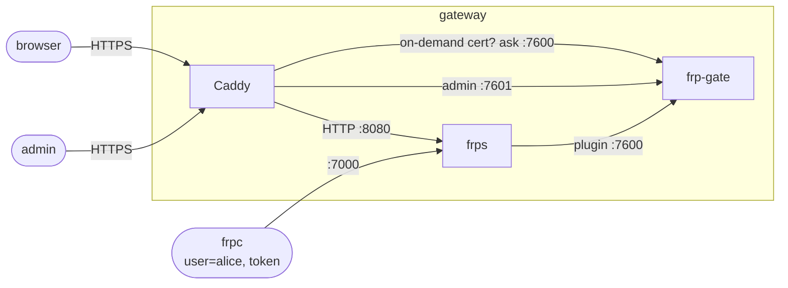

# frp-gate

[](https://github.com/telperiontech/telperion/pkgs/container/frp-gate)
[](LICENSE)

A multi-tenant gateway for [frp](https://github.com/fatedier/frp). Many people and machines share one
frps. Each client has its own token and may only claim the host names and ports it was granted.

frp-gate is the control plane that makes those decisions. It is one small Go binary (SQLite, ~25 MB
image, about 6 MB of RAM when idle) that:

1. is an **frps server plugin** (`[[httpPlugins]]`: Login, NewProxy, CloseProxy, Ping, NewWorkConn).
   It checks every client's token and every name or port it asks for;
2. answers **Caddy's on-demand TLS `ask`**, so Caddy gets a certificate per name with no DNS API
   token and no per-client config;
3. serves a small **admin UI and JSON API**, where you manage clients, zones, groups and grants and
   see who is connected right now.

The setup can also live in git as a **YAML file** that frp-gate applies at every start, so a lost
database is rebuilt as it was. `frp-gate export` and `frp-gate backup` cover the rest, and there is
an audit log and a Prometheus `/metrics` endpoint.

frp-gate never starts, stops or rewrites frps or Caddy. Their config is written once. It does not
need the Docker socket.



## Contents

- [Quick start](#quick-start)
- [Using your own Caddy](#using-your-own-caddy)
- [Client setup](#client-setup)
- [Concepts](#concepts)
- [Revocation](#revocation)
- [Declarative config](#declarative-config)
- [Backup and export](#backup-and-export)
- [Audit log](#audit-log)
- [Metrics](#metrics)
- [Configuration](#configuration)
- [JSON API](#json-api)
- [Several frps instances](#several-frps-instances)
- [Development](#development)

Design decisions and what was verified against frp and Caddy: [DESIGN.md](DESIGN.md).

## Quick start

A complete stack (Caddy + frps from [docker-frp](../docker-frp) + frp-gate) is in [`examples/`](examples):

| File | What |
| --- | --- |
| [`compose.yml`](examples/compose.yml) | the three services |
| [`frp-gate.yaml`](examples/frp-gate.yaml) | zones, server, groups, clients and grants, kept in git |
| [`Caddyfile`](examples/Caddyfile) | admin site + on-demand catch-all |
| [`frps/frps.toml`](examples/frps/frps.toml) | frps wired to frp-gate |
| [`.env.example`](examples/.env.example) | the secrets |
| [`frpc.toml`](examples/frpc.toml) | a client's config |

1. **DNS.** Point a wildcard for each zone and a name for the admin UI at the server:
   `*.dev.example.com` and `gate.example.com`.
2. **Files.** Copy `examples/` to the server. Edit `gate.example.com` and the e-mail in the
   `Caddyfile`, and the zone, clients and grants in [`frp-gate.yaml`](examples/frp-gate.yaml).
3. **Secrets.** `cp .env.example .env` and set:
   - an admin password;
   - the instance key (`openssl rand -hex 32`), shared by frps and frp-gate (frps sends it in the
     plugin URL path);
   - one token per client in `frp-gate.yaml` (`echo "fg_$(openssl rand -hex 26)"`). The file only
     names the variable (`token_env`), so it can be committed.
4. **Check and start.** `docker compose run --rm frp-gate apply --dry-run` lists what will be
   created. Then `docker compose up -d` and open the firewall for 80, 443 and 7000. frp-gate applies
   `frp-gate.yaml` at every start.
5. On the client machine, run frpc with [`frpc.toml`](examples/frpc.toml) and that client's token in
   `FRP_GATE_TOKEN`. `https://app.pc.alice.dev.example.com` works; `app.bob.dev.example.com` is
   refused for `alice`.

Later changes: edit `frp-gate.yaml`, then `docker compose exec frp-gate frp-gate apply` (or restart
frp-gate). See [Declarative config](#declarative-config).

**Without the YAML file**, leave `FRP_GATE_CONFIG` out and set everything up in the admin UI at
`https://gate.example.com`: add the zone, tick it for the `default` server (created from
`FRP_GATE_INSTANCE_KEY`), add the group, the grant `*.{client}` and the client. The client page shows
its token **once** with a ready `frpc.toml`. Both ways can be mixed; see
[ownership](#who-owns-what).

The frp-gate image runs as uid 65532 (distroless `nonroot`). A named volume works as is. For a bind
mount, `chown 65532:65532` the directory first.

## Using your own Caddy

If Caddy already runs on the gateway, add frp-gate and frps (or only frp-gate if frps runs already,
with the `[[httpPlugins]]` block and `transport.heartbeatTimeout` from
[`frps.toml`](examples/frps/frps.toml)). Then add to the Caddyfile:

```caddyfile
{
	on_demand_tls {
		ask http://127.0.0.1:7600/tls/ask
	}
}

https:// {
	tls {
		on_demand
	}
	reverse_proxy 127.0.0.1:8080 # frps vhostHTTPPort
}
```

Sites with a host name (`cloud.example.org { ... }`) always take priority over the `https://`
catch-all. Their certificates are managed as before; the on-demand policy only applies to names no
other site claims.

### If the global options set `acme_dns`

A global `acme_dns` applies to **every** ACME issuer that has no DNS provider of its own, the
on-demand catch-all included. Caddy then tries a DNS challenge for the client names, and that fails
when the DNS token does not cover those zones. A site-level `tls { issuer acme }` does not help;
Caddy 2.10 refuses that Caddyfile. Move the DNS provider from the global options into the sites
that need it:

```caddyfile
{
	# acme_dns cloudflare {env.CLOUDFLARE_API_TOKEN}   ← remove
	on_demand_tls {
		ask http://127.0.0.1:7600/tls/ask
	}
}

(dns_cert) {
	tls {
		dns cloudflare {env.CLOUDFLARE_API_TOKEN}
	}
}

cloud.example.org {
	import dns_cert
	reverse_proxy ...
}

https:// {
	tls {
		on_demand # HTTP-01 / TLS-ALPN, no DNS token needed
	}
	reverse_proxy 127.0.0.1:8080
}
```

Both forms were checked with `caddy adapt` (Caddy 2.10.2); see [DESIGN.md](DESIGN.md#caddy).

## Client setup

A client identifies itself with the frpc `user` (the client name) and its token in
`metadatas.token`. The admin UI prints this for each client:

```toml
serverAddr = "gateway.example.com"
serverPort = 7000
user = "alice"
metadatas.token = "{{ .Envs.FRP_GATE_TOKEN }}" # or the token itself

transport.heartbeatInterval = 15
transport.heartbeatTimeout = 60

[[proxies]]
name = "web"
type = "http"
localPort = 3000
customDomains = ["app.pc.alice.dev.example.com"]
requestHeaders.set.x-forwarded-proto = "https"
```

- **Heartbeats are required.** frpc turns them off by default when tcpMux is on. frps (with
  `transport.heartbeatTimeout = 60`) drops a session that sends none, so leaving these lines out
  means the client is cut off every minute.
- **Proxy names are per client, not per frpc.** frpc prefixes them with `user` (`alice.web`), so
  two frpc logged in as the same client (one per project or per device) must not reuse a name.
  frp-gate refuses the second one ("already open in another frpc session"); frps would refuse it
  anyway. Name proxies `<project>-<service>-<device>`, e.g. `webapp-web-pc`.
- **Use `customDomains` with full names.** `subdomain` is refused (see
  [DESIGN.md](DESIGN.md#subdomain-or-customdomains)). frp wildcards such as `*.pc.alice.dev.example.com`
  work if the whole wildcard is granted.
- **Proxy types:** `http`, `https`, `tcpmux` (names) and `tcp`, `udp` (an explicit `remotePort`).
  `stcp`, `xtcp` and `sudp` are refused in v1.
- `requestHeaders.set.x-forwarded-proto` is optional; frps does not pass Caddy's header on, and
  many apps need it to build `https://` links.
- With [docker-frp](../docker-frp) as the client, mount the file as `/app/configs/frpc.toml` and
  pass the token as an environment variable as above, so it lives only in the container's
  environment. docker-frp 1.3.0 and later also mask a literal `metadatas.token` (and the frps plugin
  key in `path = "/frps/…"`) in the configuration they print; 1.2.0 printed both.

## Concepts

| Concept | What it is |
| --- | --- |
| **Zone** | A base domain pointed at the gateway, e.g. `dev.webapp.example.com`. |
| **Server** | An frps that uses frp-gate as its plugin, and the zones it may serve. |
| **Client** | A named token holder: a person or machine (`alice`, `bob`, `home-pi`). The name is the frpc `user`. Tokens are random, shown once and stored as a SHA-256 hash. Clients can be disabled, re-enabled, given a new token, or deleted. |
| **Group** | A set of clients, e.g. everyone on project `webapp`. |
| **Grant** | What a client, or every member of a group, may claim: host names matching a pattern in a zone, or a tcp/udp port or range on a server. |

**Port grants and frps `allowPorts`.** frps does not tell frp-gate which ports its `allowPorts`
permits, so frp-gate cannot check a port grant against it. A granted port outside `allowPorts` is
still refused, by frps itself (frpc logs `port not allowed`), and it must also be open in the
firewall (or published, with Docker port mapping). Keep `allowPorts` and the firewall in line with
the port grants. The UI shows the same note next to port grants.

### Host patterns

A pattern is written relative to its zone (or in full). Labels are literal, `{client}`, or (only
leftmost) `*`:

| Pattern in zone `dev.example.com` | `alice` may use | `alice` may not use |
| --- | --- | --- |
| `*.{client}` | `app.alice…`, `api.pc.alice…`, `*.pc.alice…` | `alice.dev.example.com`, `app.bob…` |
| `{client}` | `alice.dev.example.com` | `app.alice…` |
| `status` | `status.dev.example.com` (anyone holding this grant) | anything else |
| `@` | `dev.example.com` itself | |

`*` stands for **one or more** labels of any depth. That is also how frps routes its wildcard
domains. One group grant `*.{client}` gives every member their own subtree.

## Revocation

Disabling a client, rotating its token, or removing a grant takes effect without touching frps:

| Plugin op | What frp-gate does |
| --- | --- |
| **Ping** | Refused for a disabled client, or for a session holding a proxy whose grant is gone. frpc closes the session when the Pong carries the error. If a client ignores that, frps closes the session itself once `heartbeatTimeout` passes without an accepted Ping. |
| **NewWorkConn** | Refused for a disabled client, so it gets no new work connections. |
| **Login** | Refused, so the client cannot reconnect. |
| **TLS ask** | Refused at once for a disabled client's names. |

In practice a disabled client is cut off at its next heartbeat: **within 15 s**, or at most 60 s for
a client that ignores the error. The integration test measures this; see
[DESIGN.md](DESIGN.md#revocation).

### TLS ask modes

`FRP_GATE_ASK_MODE=claimed` (default) approves a name only if it is granted to an enabled client
**and** that client used it in an accepted proxy in the last `FRP_GATE_CLAIM_RETENTION` (30 days).
Without the second condition anyone could make Caddy request certificates for random names under
`*.{client}.<zone>` and use up the ACME rate limits for the domain. `granted` drops that condition.

## Declarative config

The whole setup (zones, servers, groups, clients and grants) can be written in one YAML file and
kept in git next to the rest of the gateway. Example: [`examples/frp-gate.yaml`](examples/frp-gate.yaml).

```yaml
zones: [example.org, dev.webapp.example.net]
instances:
  default: { server_addr: gate.example.org:7000, zones: [example.org, dev.webapp.example.net] }
groups: [webapp]
clients:
  home-pi:
    note: Pi frpc
    token_env: FRP_GATE_TOKEN_HOME_PI      # or token_file, or token_sha256
    groups: []
grants:
  - { client: home-pi, kind: host, zone: example.org, pattern: "*" }
  - { client: home-pi, kind: port, instance: default, proto: tcp, ports: "25565" }
  - { group: webapp, kind: host, zone: dev.webapp.example.net, pattern: "*.{client}" }
```

| Key | Meaning |
| --- | --- |
| `zones` | Base domains. |
| `instances.<name>` | An frps: `server_addr` (for frpc.toml snippets), `zones` it serves, and its plugin key from `key_env`, `key_file` or `key_sha256`. Without a key source an existing server keeps its key: the usual case for `default`, whose key comes from `FRP_GATE_INSTANCE_KEY`. |
| `groups` | Group names. |
| `clients.<name>` | `note`, `groups` (its memberships), `disabled` (optional, see below) and the token from **one** of `token_env` (an environment variable of frp-gate), `token_file` (e.g. a Docker secret) or `token_sha256` (the hash, as `export` writes it). Tokens must be at least 32 characters. |
| `grants` | `client` or `group`, `kind: host` with `zone` + `pattern` (relative to the zone, `@` for the zone itself), or `kind: port` with `instance` + `proto` + `ports` (`25565` or `6000-6010`). |

Every name a grant, client or server refers to must be declared in the same file, so the file alone
can rebuild the database.

### Applying it

- **At start:** set `FRP_GATE_CONFIG=/path/frp-gate.yaml`. frp-gate applies it after
  `FRP_GATE_INSTANCE_KEY` and before it starts listening. **If the file is invalid, frp-gate does not
  start**; it exits with every problem listed and the database unchanged. Check a change with a dry
  run before restarting (from Ansible, for example).
- **On demand:** `frp-gate apply [-f FILE] [--dry-run]` (the file defaults to `$FRP_GATE_CONFIG`).
  Run it in the container: `docker exec frp-gate frp-gate apply --dry-run`. It uses the same database
  as the running server, which uses the change at once: no restart needed.

```console
$ docker exec frp-gate frp-gate apply --dry-run
+ client bob
~ group webapp: + member bob
~ client home-pi: note "Pi frpc" → "Pi 5 frpc"
- grant client home-pi: tcp 25565 on default
Dry run: 4 change(s) would be made. Nothing was changed.
```

`+` create, `~` update, `-` delete, `=` adopt (see below). The whole file is validated first, and all
changes are made in one transaction: either everything is applied or nothing. An empty file is
refused (it would delete every managed object). Each change is written to the [audit log](#audit-log).

**Tokens are never logged or printed.** A client with a token source keeps that token: rebuilding
the database from the file gives it the same token, so its frpc keeps working. A token change shows
as `token changed`.

### Who owns what

- Objects declared in the file are **managed**. Apply creates and updates them, and deletes managed
  objects that are no longer in the file.
- Objects made in the UI or API are **never touched by apply**: not changed, not deleted. A grant made
  in the UI for a managed client stays the UI's.
- The UI marks managed objects and does not let you edit or delete them; the API answers `409`. Change
  the file instead. A managed group's members are set by the file (the clients' `groups`).
- **Disable stays available** for managed clients, as an emergency switch when git is out of reach.
  Apply changes `disabled` only if the file says `disabled: true` or `disabled: false`, so a UI
  disable survives later applies and restarts. Without `disabled` in the file, a client comes back
  enabled when the database is rebuilt from scratch; write `disabled: true` to keep it off.
- A token or key declared in the file cannot be rotated in the UI. A managed client **without** a
  token source gets a random token that is never shown; rotate it in the UI to get one (apply leaves
  undeclared tokens alone).
- **Adoption:** an object in the file with the same name as one made in the UI (or an identical
  grant) becomes managed. It keeps its id, sessions and, if the token matches, its token. The dry run
  shows it as `=`.

### Moving an existing setup to a file

`frp-gate export > frp-gate.yaml` writes the current database in this format, with tokens and keys as
`token_sha256` / `key_sha256`. Applying it adopts everything without changing any token. Replace the
hashes with `token_env` / `token_file` where you have the token itself. A dry run should then report
only adoptions.

## Backup and export

- `frp-gate export` prints the whole database (managed objects and those made in the UI) as YAML. It
  holds no secret, only SHA-256 hashes, but it does list your clients and names.
- `frp-gate backup FILE` writes a consistent copy of the SQLite database while frp-gate runs
  (`VACUUM INTO`); it refuses to overwrite a file. `frp-gate backup -` writes the copy to stdout,
  which suits the distroless image (no shell, no `cp`):

```bash
# cron on the gateway: a daily copy, kept for 14 days, then shipped off the server
docker exec frp-gate frp-gate backup - > /var/backups/frp-gate/$(date +%F).db
find /var/backups/frp-gate -name '*.db' -mtime +14 -delete
```

The database holds token **hashes**, the admin session key and recent sessions, not tokens. With a
declarative config the file already rebuilds clients, grants and tokens; the backup adds what the
file does not have: objects made in the UI, last logins, claims and the audit log.

## Audit log

The **Audit** page (and `GET /api/v1/audit`) lists admin actions, newest first: what was done
(`client.disable`, `grant.create`, …), to which object, when, and through what: `ui`, `api`, `apply`
(the CLI) or `start` (`FRP_GATE_CONFIG` / `FRP_GATE_INSTANCE_KEY`). For the UI and API it records the
remote address and Caddy's `X-Forwarded-For`. It never holds a token or key, only "token rotated" and
the like. The newest 10,000 entries are kept.

## Metrics

`GET /metrics` on the **internal** listener (`:7600`, next to the plugin) serves Prometheus text:

| Metric | Labels | Meaning |
| --- | --- | --- |
| `frp_gate_sessions_connected` | `client` | Sessions with a heartbeat within `FRP_GATE_SESSION_TIMEOUT`. Every client is listed, `0` when not connected, so `frp_gate_sessions_connected{client="home-pi"} == 0` makes a good alert. |
| `frp_gate_plugin_ops_total` | `op`, `result`, `reason` | frps plugin calls (`Login`, `NewProxy`, `Ping`, …), `allow` or `reject`, with a short reason code: `bad_token`, `disabled`, `no_grants`, `host_not_granted`, `port_not_granted`, `name_in_use`, `subdomain`, `unknown_instance`, … |
| `frp_gate_tls_ask_total` | `result`, `reason` | Caddy's TLS asks: `not_granted`, `not_claimed`, `bad_name`, … |
| `frp_gate_build_info` | `version` | Always 1. |

Counters start at zero when frp-gate starts. Scrape it from the gateway itself
(`127.0.0.1:7600/metrics` with host networking); do not publish the internal listener.

## Configuration

All settings are environment variables.

| Variable | Default | Meaning |
| --- | --- | --- |
| `FRP_GATE_ADMIN_PASSWORD` | (required) | Admin UI/API password, at least 12 characters. `FRP_GATE_ADMIN_PASSWORD_FILE` reads it from a file. |
| `FRP_GATE_INSTANCE_KEY` | (none) | If set, a server named `FRP_GATE_INSTANCE_NAME` uses this plugin key (at least 32 characters). This lets frps.toml be written before frp-gate first starts. `_FILE` variant supported. |
| `FRP_GATE_INSTANCE_NAME` | `default` | Name of that server. |
| `FRP_GATE_INSTANCE_SERVER_ADDR` | (empty) | `host:port` frpc clients connect to; used in frpc.toml snippets. |
| `FRP_GATE_CONFIG` | (none) | [Declarative config](#declarative-config) file, applied at every start. An invalid file stops the start. `frp-gate apply` uses it as its default file. |
| `FRP_GATE_DB` | `/data/frp-gate.db` | SQLite file. Back it up ([`frp-gate backup`](#backup-and-export)). |
| `FRP_GATE_INTERNAL_ADDR` | `:7600` | Listener for the frps plugin, `/tls/ask`, `/healthz` and `/metrics`. Keep it private. |
| `FRP_GATE_ADMIN_ADDR` | `:7601` | Listener for the admin UI and API. Put HTTPS (Caddy) in front. |
| `FRP_GATE_PLUGIN_ADDR` | `frp-gate:7600` | How frps reaches frp-gate; used in frps.toml snippets. |
| `FRP_GATE_ASK_MODE` | `claimed` | `claimed` or `granted`; see [TLS ask modes](#tls-ask-modes). |
| `FRP_GATE_CLAIM_RETENTION` | `720h` | How long a used name stays approved for the TLS ask. |
| `FRP_GATE_SESSION_TIMEOUT` | `90s` | A session counts as connected if it sent a heartbeat this recently. |
| `FRP_GATE_LOG_LEVEL` | `info` | `debug`, `info`, `warn`, `error`. Decisions to refuse are logged at `info`. |

Ports: **7600** (internal: plugin, ask, health) and **7601** (admin). The image has a `HEALTHCHECK`
(`frp-gate healthcheck`).

## JSON API

Under `/api/v1/` on the admin listener, with HTTP Basic auth (any user name, the admin password).
Objects are addressed by name.

| Method and path | Body / result |
| --- | --- |
| `GET status` | connected sessions with their proxies |
| `GET clients`, `GET clients/{name}` | clients; one client with its grants and frpc.toml |
| `POST clients` | `{"name","note","groups":[]}` → `{"client","token","frpc_toml"}` |
| `POST clients/{name}/disable` · `/enable` · `/rotate` | rotate returns the new `token` |
| `DELETE clients/{name}` | |
| `GET zones`, `POST zones`, `DELETE zones/{domain}` | `{"domain"}` |
| `GET instances`, `POST instances` | `{"name","server_addr","zones":[]}` → `{"instance","key","frps_toml"}` |
| `PUT instances/{name}/zones`, `POST instances/{name}/rotate`, `DELETE instances/{name}` | `{"zones":[]}` |
| `GET groups`, `POST groups`, `DELETE groups/{name}` | `{"name"}` |
| `PUT` / `DELETE groups/{name}/members/{client}` | |
| `GET grants`, `POST grants`, `DELETE grants/{id}` | see below |
| `GET audit?before={id}` | `{"entries":[…],"next_before"}`, newest first, 100 per page |

Objects carry `"managed": true` when they come from the [config file](#declarative-config). Editing
or deleting them answers `409` with a message to change the file instead; disabling a managed client
works.

```bash
api() { curl -fsS -u "admin:$FRP_GATE_ADMIN_PASSWORD" -H 'Content-Type: application/json' "https://gate.example.com/api/v1/$@"; }
api zones -d '{"domain":"dev.example.com"}'
api grants -d '{"group":"webapp","kind":"host","zone":"dev.example.com","pattern":"*.{client}"}'
api grants -d '{"client":"home-pi","kind":"port","instance":"default","proto":"tcp","ports":"25565"}'
api clients -d '{"name":"bob","groups":["webapp"]}'
api clients/bob/disable -X POST
```

## Several frps instances

One frps serves every zone; grants keep clients apart. You can still point several frps at one
frp-gate, for example one per network or region. Add a server under **Servers** (or
`POST /api/v1/instances`). Each server gets its own key in its plugin path and serves only the zones
ticked for it. Host grants count only in those zones, and port grants belong to one server.

## Development

Go is not needed locally: builds and tests run in Docker.

```bash
pnpm nx run frp-gate:test                          # go vet + unit tests (docker build --target test)
pnpm nx run frp-gate:test-integration              # real frps + frpc + frp-gate (frp 0.72.0)
pnpm nx run frp-gate:test-integration:frp-0.65     # same against frp 0.65.0
pnpm nx run frp-gate:build                         # image telperiontech/frp-gate:latest
pnpm nx run frp-gate:run                           # admin UI on http://localhost:7601
```

The integration test is a bash script. On Windows run it from Git Bash; in PowerShell, `bash` is
usually WSL's, which does not see Docker Desktop the same way. It builds frps and frpc from
[`../docker-frp`](../docker-frp) in the same checkout, declares a client in
[`gate.yaml`](test/integration/gate.yaml), and at the end deletes frp-gate's database volume to check
that the client works again after the rebuild.

Layout: `cmd/frp-gate` (main and CLI commands), `internal/pattern` (host patterns),
`internal/policy` (all decisions), `internal/frpplugin` (frps plugin protocol, frp's own types),
`internal/ask`, `internal/admin` (UI, API), `internal/declare` (config file: validate, apply, export),
`internal/metrics`, `internal/audit`, `internal/store` (SQLite), `test/integration`.

### Release

Push a tag `frp-gate-vX.Y.Z`, or publish a GitHub release that creates it:

```bash
gh release create frp-gate-v1.1.0 --title "frp-gate v1.1.0" --notes "..."
```

[`frp-gate.publish.yml`](../../.github/workflows/frp-gate.publish.yml) runs the unit and integration
tests and pushes `ghcr.io/telperiontech/frp-gate:X.Y.Z` and `:latest` for amd64 and arm64.

## License

[Apache 2.0](LICENSE)
